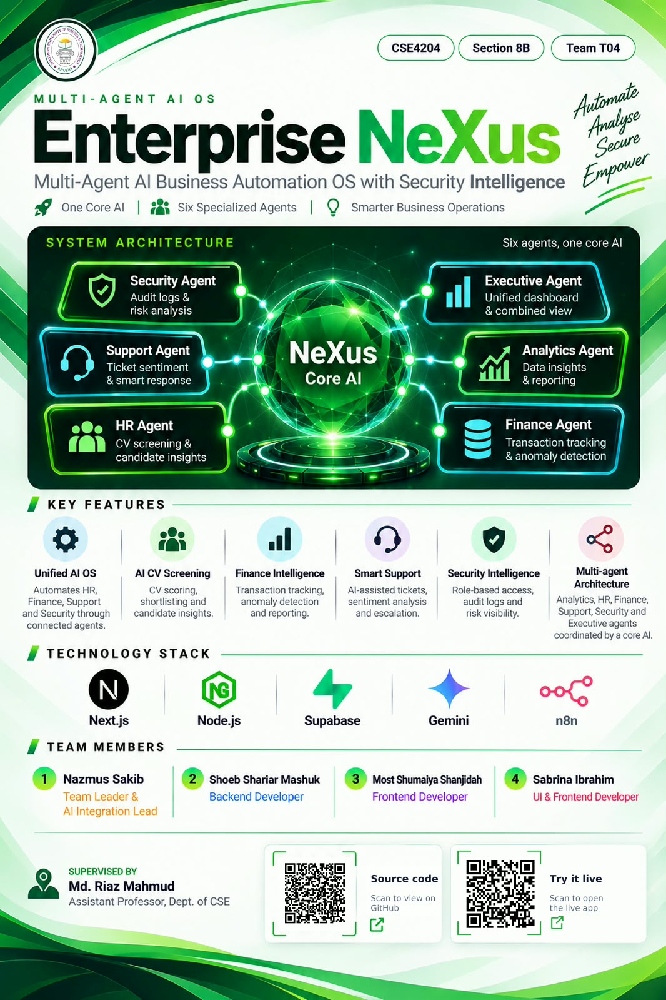
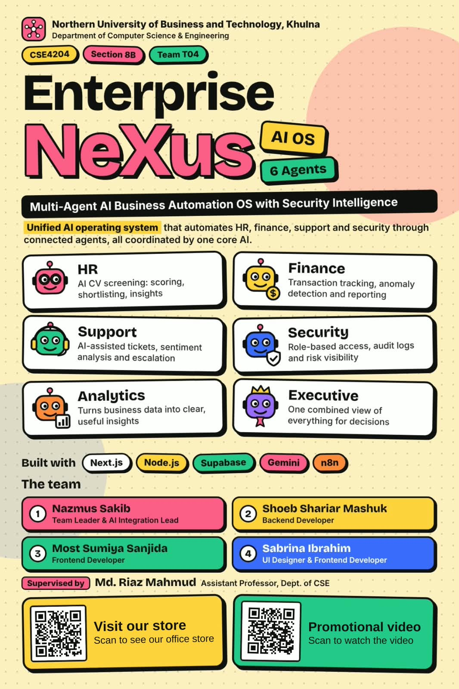
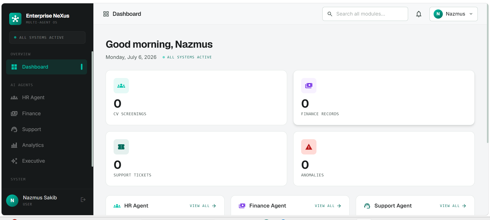
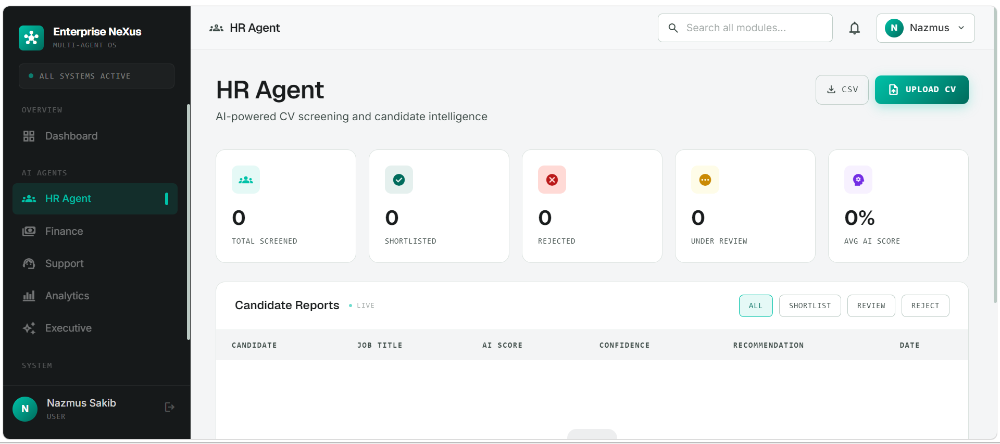
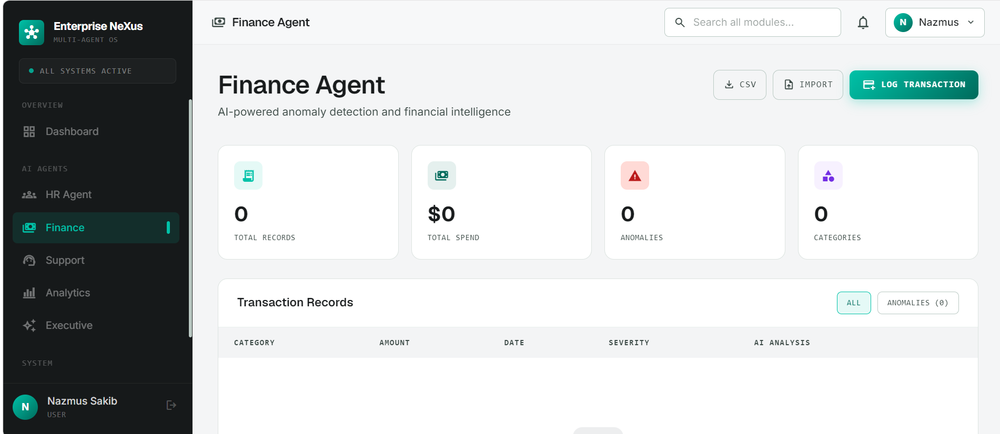
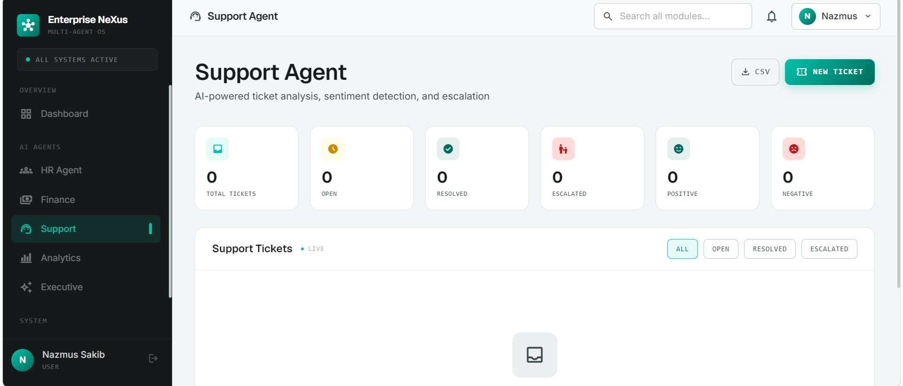
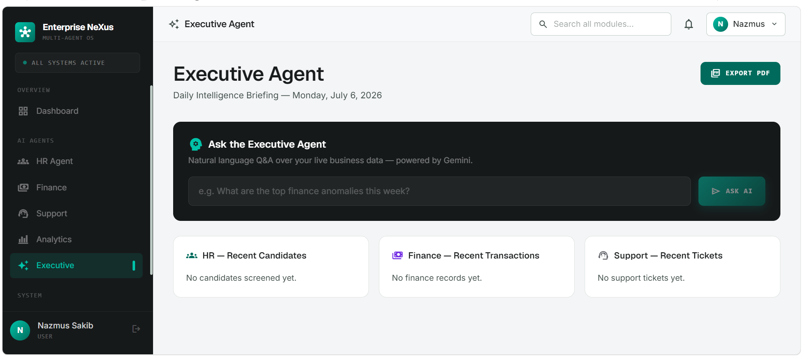

# Enterprise NeXus

## Multi-Agent AI Business Automation OS with Security Intelligence

**Automate. Analyse. Secure. Empower.**

Enterprise NeXus is a business automation platform for startups, small businesses, and growing teams. It combines specialized AI agents, a shared orchestration layer, secure REST APIs, workflow automation, and a role-based dashboard in one system.

The platform helps a lean team screen candidates, monitor finance, answer customers, generate KPI reports, prepare executive briefings, and review security signals from one workspace.

## Project overview

- **Project type:** Multi-agent AI business automation operating system
- **Primary audience:** Startups, small businesses, growing teams, and exhibition reviewers
- **Academic context:** CSE4204, Section 8B, Team T04
- **Institution:** Northern University of Business and Technology, Khulna
- **Department:** Department of Computer Science and Engineering
- **Supervisor:** Md. Riaz Mahmud, Assistant Professor, Department of CSE

## Team members

| Responsibility | Member | Student ID |
|---|---|---|
| Team Leader and AI Integration Lead | [Nazmus Sakib](https://www.linkedin.com/in/nazmussakib247/) | 11220320888 |
| Backend Developer | [Shoeb Shariar Mashuk](https://www.linkedin.com/in/shoeb-shariar-masuk-b9a762326) | 11220320878 |
| Frontend Developer | [Most Sumiya Sanjida](https://bd.linkedin.com/in/shumaiya-shanjidah-65337b42b) | 11220320874 |
| UI and Frontend Developer | [Sabrina Ibrahim](https://www.linkedin.com/in/sabrina-ibrahim-khushbu-98a00338b/) | 11220320895 |

---

## Live system

| Surface | Link |
|---|---|
| Main application | [enterprise-nexus-delta.vercel.app](https://enterprise-nexus-delta.vercel.app) |
| Customer store | [enterprise-nexus-delta.vercel.app/store](https://enterprise-nexus-delta.vercel.app/store) |
| Careers and applications | [enterprise-nexus-delta.vercel.app/careers](https://enterprise-nexus-delta.vercel.app/careers) |
| Backend health endpoint | [enterprise-nexus-backend.onrender.com/api/health](https://enterprise-nexus-backend.onrender.com/api/health) |
| Source repository | [GitHub](https://github.com/Nazmussakib247/CSE4204-8B-T04-Enterprise-Nexus-Multi-Agent-AI-Business-Automation-OS-with-Security-Intelligence) |

- **Frontend:** Hosted on Vercel
- **Backend API:** Hosted on Render
- **Database, realtime data, and vector search:** Hosted on Supabase
- **Workflow automation:** Hosted and operated through n8n

### Promotional video

[Watch the Enterprise NeXus promotional video on YouTube](https://youtu.be/VXz9r8ys9jY?feature=shared).

---

## Project posters

The green poster is the primary exhibition poster and summarises the architecture, agents, capabilities, technology stack, and team. A second visual poster is included for presentation and promotional use.

### Primary poster

### Alternate poster

---

## Why this project exists

Early-stage businesses face a practical capacity problem:

- Hiring separate HR, finance, support, analytics, and executive staff is expensive.
- Important decisions are delayed when records are spread across different tools.
- Manual CV review and financial review are inconsistent and time-consuming.
- Customer questions need fast, contextual replies even when no specialist is available.
- Owners need a concise view of business health instead of reading every file and ticket.
- Security events can be missed when monitoring is disconnected from daily operations.

Enterprise NeXus turns these recurring workflows into a coordinated, auditable operating layer while keeping human review available for decisions that need judgment.

---

## Product goals

1. Provide practical automation for small teams with limited time and budget.
2. Keep HR, finance, support, analytics, security, and executive reporting in one workspace.
3. Use AI for structured analysis, retrieval, drafting, and prioritisation.
4. Preserve human control through roles, audit logs, approvals, escalations, and fallbacks.
5. Make the system deployable as a real web application with separate services.

---

## Core capabilities

### HR Agent

- Publishes job openings to the careers portal.
- Accepts PDF, DOCX, and TXT CVs.
- Extracts candidate profile information.
- Scores candidates against role-specific screening criteria.
- Shows AI score, confidence, recommendation, skill breakdown, summary, strengths, and weaknesses.
- Supports shortlist, review, reject, approval, notification, and application tracking.

### Finance Agent

- Logs financial records and imports supported data.
- Tracks spend, store revenue, orders, and categories.
- Detects unusual transaction patterns.
- Classifies anomaly severity and explains why a record was flagged.
- Presents trend charts and record-level analysis.

### Support Agent

- Creates and manages customer support tickets.
- Classifies intent, sentiment, and urgency.
- Uses business context and retrieved knowledge to draft relevant replies.
- Supports AI replies, staff replies, escalation, resolution, and customer follow-up.
- Analyses product reviews, replies to positive reviews, and flags negative or high-urgency reviews.
- Automatically closes inactive tickets after the configured customer inactivity window.

### Analytics Agent

- Combines cross-module operational data.
- Produces KPI snapshots and trend summaries.
- Supports queued report generation through the workflow layer.
- Highlights backlog, revenue, hiring, support, and anomaly trends.

### Executive Agent

- Acts as the management-facing entry point.
- Delegates questions to HR, Finance, Support, Analytics, and Security data.
- Maintains conversation context.
- Produces business briefings, risks, priorities, alerts, and recommended next actions.

### Security Intelligence

- Records security and authentication events.
- Surfaces threat and anomaly signals.
- Supports role-based access, account approval, activation, deactivation, protected deletion, session revocation, and audit logging.
- Keeps queries scoped to the authenticated user or authorised office role.

### Store and careers portal

- Public customer store with product orders and order-specific reviews.
- Customer-facing support conversations.
- Public job listings and CV applications.
- Connects customer and applicant actions to internal agents.

---

## Multi-agent orchestration

The Executive Agent receives a request, identifies relevant domains, delegates to specialised agents, gathers structured outputs, and composes one response.

~~~mermaid
flowchart LR
    U[Owner or staff member] --> UI[Next.js dashboard]
    UI --> API[Express REST API]
    API --> AUTH[JWT and RBAC middleware]
    AUTH --> ORCH[Executive orchestration layer]
    ORCH --> HR[HR Agent]
    ORCH --> FIN[Finance Agent]
    ORCH --> SUP[Support Agent]
    ORCH --> ANA[Analytics Agent]
    ORCH --> SEC[Security intelligence]
    HR --> DB[(Supabase PostgreSQL)]
    FIN --> DB
    SUP --> DB
    ANA --> DB
    SEC --> DB
    ORCH --> LLM[Gemini structured generation]
    API --> N8N[n8n workflows]
    N8N --> LLM
    N8N --> API
    DB --> OUT[Dashboard, reports, notifications]
    ORCH --> OUT
~~~

### AI request lifecycle

~~~mermaid
sequenceDiagram
    participant User
    participant Frontend
    participant API
    participant Agent
    participant Gemini
    participant Database

    User->>Frontend: Submit request or record
    Frontend->>API: Authenticated REST request
    API->>Agent: Validate and scope the task
    Agent->>Gemini: Structured prompt with relevant context
    Gemini-->>Agent: JSON response
    Agent->>API: Validate, normalise, and apply business rules
    API->>Database: Save result and status
    Database-->>Frontend: Updated operational view
    Frontend-->>User: Analysis, recommendation, or next action
~~~

When AI is unavailable or returns invalid output, the backend stores an explicit pending or failed status and exposes a retry path. It does not fabricate a result.

---

## AI design

- **Primary model:** Google Gemini, configurable through GEMINI_MODEL.
- **AI client:** Shared client with timeout, retry, backoff, and typed unavailable errors.
- **Output control:** Native JSON response mode plus schema validation and normalisation.
- **Retrieval:** Gemini embeddings stored in Supabase pgvector and queried through the match_documents RPC.
- **Prompt boundaries:** Each agent has a scoped role prompt and avoids inventing facts.
- **Workflow fallback:** n8n retries failed AI work and generates scheduled analytics and executive reports.

---

## Technology stack

| Layer | Technology | Purpose |
|---|---|---|
| Web application | Next.js 14, React 18, TypeScript | Dashboard, store, careers portal, responsive UI |
| Styling | Tailwind CSS | Design system and responsive layouts |
| Backend | Node.js 20+, Express.js | REST API, business logic, agent execution |
| AI | Google Gemini, LangChain.js | Structured generation, tool-calling, orchestration |
| Retrieval | Supabase pgvector | Embeddings and semantic knowledge retrieval |
| Database | PostgreSQL on Supabase | Users, roles, records, tickets, reviews, reports, tasks |
| Authentication | JWT, bcryptjs, HTTP-only cookies | Sign-in and session handling |
| Workflow automation | n8n | Scheduled jobs, callbacks, retries, alerts |
| Validation | Joi, Zod, custom normalisers | Request and AI output validation |
| Security | Helmet, CORS, rate limiting, audit logs, Sentry | Hardening and traceability |
| Hosting | Vercel, Render, Supabase | Frontend, API, database, realtime, vector search |
| Version control | GitHub | Collaboration and deployment source |

---

## Hosting and deployment

| Component | Hosted on | Responsibility |
|---|---|---|
| Next.js frontend | Vercel | Public dashboard, store, careers, and API rewrite |
| Express backend | Render | API, agents, integrations, and health checks |
| PostgreSQL and pgvector | Supabase | Relational data, embeddings, and realtime |
| Workflow automation | n8n | Reports, retries, callbacks, and automation |
| Monitoring | Render, UptimeRobot, Sentry | Availability and application monitoring |
| Source and CI | GitHub | Branches, review, and deployment source |

Backend health monitor:

~~~text
https://enterprise-nexus-backend.onrender.com/api/health
~~~

Health and readiness endpoints bypass the application rate limiter so monitoring does not create false 429 failures. See [DEPLOYMENT.md](DEPLOYMENT.md) for deployment instructions.

---

## Repository layout

~~~text
.
├── backend/
│   ├── src/
│   │   ├── agents/          # HR, Finance, Support, Analytics, Executive
│   │   ├── ai/              # Base agent, Gemini client, embeddings, errors
│   │   ├── controllers/     # REST controllers and business workflows
│   │   ├── middleware/      # Auth, validation, uploads, errors
│   │   ├── routes/           # API route modules
│   │   ├── tests/            # Unit and integration tests
│   │   └── server.js
│   ├── Dockerfile
│   ├── package.json
│   └── render.yaml
├── frontend/
│   ├── src/app/              # Public pages and dashboard modules
│   ├── src/components/       # Shared UI, layout, charts, modals
│   ├── src/lib/              # API clients, auth, shared utilities
│   ├── package.json
│   └── next.config.js
├── supabase/migrations/      # Database schema and feature migrations
├── database/                 # Database reference scripts
├── n8n-workflows/             # Importable workflows and guide
├── documentation/             # Proposal, SRS, reports, and diagrams
├── screenshots/               # Product UI screenshots
├── postman/                  # API collection
├── assets/                   # Enterprise NeXus logos and icons
├── DEPLOYMENT.md
├── docker-compose.yml
└── README.md
~~~

---

## Selected product screens

### Dashboard

### HR Agent

### Finance Agent

### Support Agent

### Executive Agent

More screens: [screenshots/00-ui-screenshots](screenshots/00-ui-screenshots).

---

## Getting started locally

### Prerequisites

- Node.js 20 or newer
- npm
- Supabase project with the required migrations
- Google Gemini API key
- Optional n8n instance for scheduled and retry workflows

### Clone and install

~~~bash
git clone https://github.com/Nazmussakib247/CSE4204-8B-T04-Enterprise-Nexus-Multi-Agent-AI-Business-Automation-OS-with-Security-Intelligence.git
cd CSE4204-8B-T04-Enterprise-Nexus-Multi-Agent-AI-Business-Automation-OS-with-Security-Intelligence

cd backend
npm install

cd ../frontend
npm install
~~~

### Configure environment

Copy the example files and fill in local values. Never commit secrets.

~~~powershell
copy backend\.env.example backend\.env
copy frontend\.env.example frontend\.env.local
~~~

Backend values include SUPABASE_URL, SUPABASE_SERVICE_ROLE_KEY, SUPABASE_ANON_KEY, JWT_SECRET, GEMINI_API_KEY, FRONTEND_URL, N8N_WEBHOOK_URL, and N8N_SECRET.

Frontend values include NEXT_PUBLIC_API_URL, NEXT_PUBLIC_SUPABASE_URL, and NEXT_PUBLIC_SUPABASE_ANON_KEY.

Apply migrations from [supabase/migrations](supabase/migrations), then start the services:

~~~bash
cd backend
npm run dev
~~~

In a second terminal:

~~~bash
cd frontend
npm run dev
~~~

Local frontend: http://localhost:3000
Local API: http://localhost:5000

The repository also includes [docker-compose.yml](docker-compose.yml) for a local multi-service setup.

---

## n8n workflows

The [n8n-workflows](n8n-workflows) directory contains importable definitions for:

1. HR shortlist and CV screening
2. Finance anomaly alerts
3. Support auto-escalation
4. Daily executive briefings
5. Weekly analytics KPI reports
6. Store review support replies
7. Failed support AI retries
8. Job application screening

Inbound webhooks and backend callbacks use the shared N8N_SECRET. Read [n8n-workflows/README.md](n8n-workflows/README.md) for setup and testing instructions.

---

## Security and reliability

- Role-based route authorisation for customer, candidate, employee, manager, and admin access.
- Password hashing with bcryptjs.
- HTTP-only cookies and server-side session revocation.
- Helmet security headers, CORS policy, rate limiting, request validation, and correlation IDs.
- Per-user data scoping in agent tools and database queries.
- Audit logging for administrative changes and security-sensitive actions.
- Upload validation for CV and document workflows.
- AI timeout and retry handling with explicit failure states.
- Health and readiness endpoints for Render and uptime monitoring.
- Graceful degradation when Gemini or n8n is unavailable.
- Manual escalation paths for support complaints and sensitive decisions.

---

## Documentation

| Resource | Link |
|---|---|
| Proposal | [CSE4204-8B-T04_Proposal.pdf](documentation/proposal/CSE4204-8B-T04_Proposal.pdf) |
| Software Requirements Specification | [CSE4204-8B-T04_SRS.pdf](documentation/srs/CSE4204-8B-T04_SRS.pdf) |
| System design | [CSE4204-8B-T04_SystemDesign.pdf](documentation/system-design/CSE4204-8B-T04_SystemDesign.pdf) |
| Architecture diagram | [CSE4204-8B-T04_ArchitectureDiagram.pdf](documentation/diagram/architecture/CSE4204-8B-T04_ArchitectureDiagram.pdf) |
| Entity relationship diagram | [CSE4204-8B-T04_ERDiagram.pdf](documentation/diagram/er-diagram/CSE4204-8B-T04_ERDiagram.pdf) |
| Use case diagram | [CSE4204-8B-T04_UseCaseDiagram.pdf](documentation/diagram/use-case-diagram/CSE4204-8B-T04_UseCaseDiagram.pdf) |
| UI design report | [CSE4204-8B-T04_UIDesign_Report.pdf](documentation/ui-design/CSE4204-8B-T04_UIDesign_Report.pdf) |
| AI integration report | [CSE4204-8B-T04_AIIntegrationReport.pdf](documentation/ai-integration/CSE4204-8B-T04_AIIntegrationReport.pdf) |
| Backend progress report | [Backend and database report](documentation/backend-progress/CSE-8B-T04-Backend-Development-&-Database-Implementation.pdf) |
| Frontend progress report | [CSE4204-8B-T04_FrontendProgress.pdf](documentation/frontend-progress/CSE4204-8B-T04_FrontendProgress.pdf) |
| Feature completion report | [CSE4204-8B-T04_Week09Progress.pdf](documentation/feature-completion/CSE4204-8B-T04_Week09Progress.pdf) |
| API collection | [Postman collection](postman/CSE4204-8B-T04_APICollection.json) |
| Architecture images | [documentation/diagram](documentation/diagram) |
| UI screenshots | [screenshots/00-ui-screenshots](screenshots/00-ui-screenshots) |

---

## Project status

Enterprise NeXus is an academic exhibition project with a deployed demonstration environment. Core workflows are implemented across the dashboard, customer store, careers portal, AI agents, orchestration layer, workflow automation, and security controls. Production use should follow an environment-specific security review, data retention policy, and operational monitoring plan.

---

## License

See [LICENSE](LICENSE).
